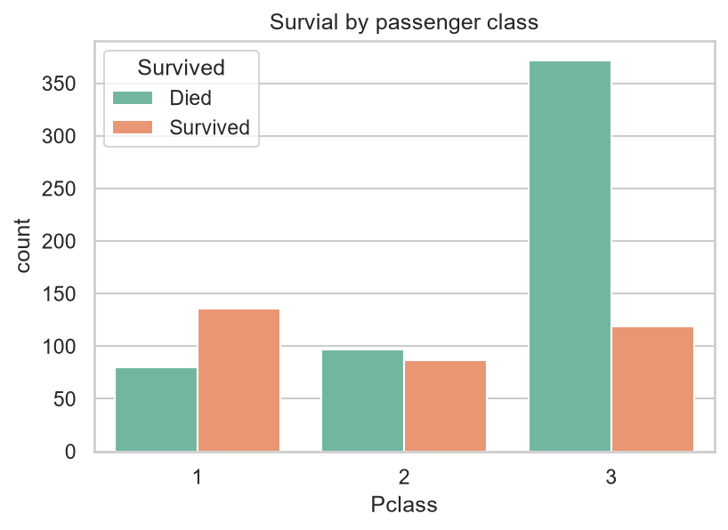
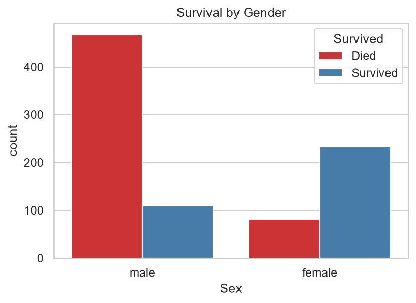
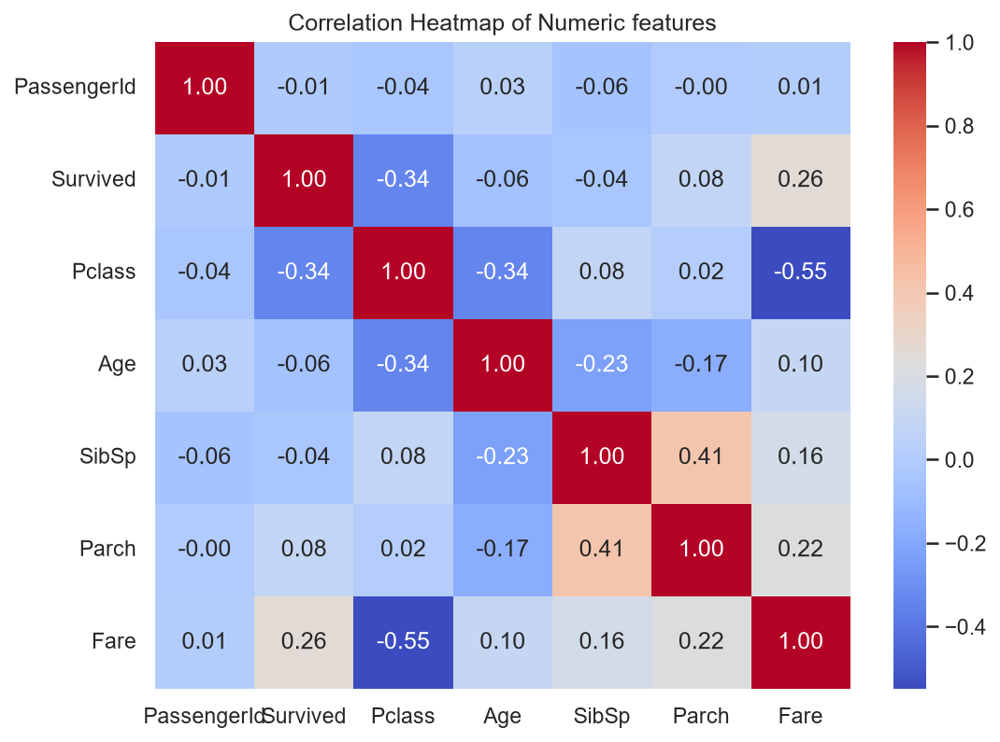

# Titanic Dataset — Exploratory Data Analysis & ML Pipeline

A comprehensive Exploratory Data Analysis (EDA) and Machine Learning pipeline on the famous Titanic dataset to uncover the factors that influenced passenger survival and predict outcomes.

## Business Question
Which passenger characteristics (age, sex, class, fare) had the strongest impact on survival rates, and can we build a predictive model to accurately determine survival?

## Tech Stack
- Python
- Pandas (Data manipulation & cleaning)
- Matplotlib & Seaborn (Visualization)
- Scikit-Learn (Machine Learning & Model Evaluation)
- Jupyter Notebooks

## Key Insights
1. **Gender:** Females had a significantly higher survival rate compared to males.
2. **Class:** Passenger class was a strong predictor of survival; 1st class passengers had the highest survival rate.
3. **Fare:** Paying a higher fare was positively correlated with a higher chance of survival.

## Machine Learning Models & Comparison
After completing the EDA, I built, tuned, and compared two predictive models using a 5-fold Cross-Validation strategy.

- **Features Used:** Pclass, Age, SibSp, Parch, Fare, Sex (One-Hot Encoded), Embarked (One-Hot Encoded).
- **Model 1 (Logistic Regression):** Achieved a **78.09% test accuracy** and a **79.08% average cross-validation score**.
- **Model 2 (Tuned Random Forest):** Using `GridSearchCV`, I found the optimal hyperparameters (`n_estimators=200`, `max_depth=10`, `min_samples_split=2`). The tuned model achieved a **79.78% test accuracy** and an **83.83% best cross-validation score**, successfully outperforming the baseline.

**Conclusion:** While Logistic Regression is a strong baseline for this dataset, a properly tuned Random Forest slightly edges it out by capturing more complex non-linear relationships. 

## Project Structure
- `data/`: Contains the raw Titanic dataset.
- `notebooks/titanic_eda.ipynb`: The main Jupyter Notebook with all code, cleaning steps, visualizations, and detailed insights.
- `notebooks/titanic_ml_baseline.ipynb`: Machine Learning pipeline (Feature Engineering, Model Training, Cross-Validation, and Hyperparameter Tuning).
- `images/`: Visual highlights for the README.

## Visual highlights




## How to Run
1. Clone this repository.
2. Create a virtual environment: `python -m venv .venv`
3. Activate the environment (Windows: `.venv\Scripts\activate` | Mac/Linux: `source .venv/bin/activate`).
4. Install dependencies: 
   ```bash
   pip install -r requirements.txt