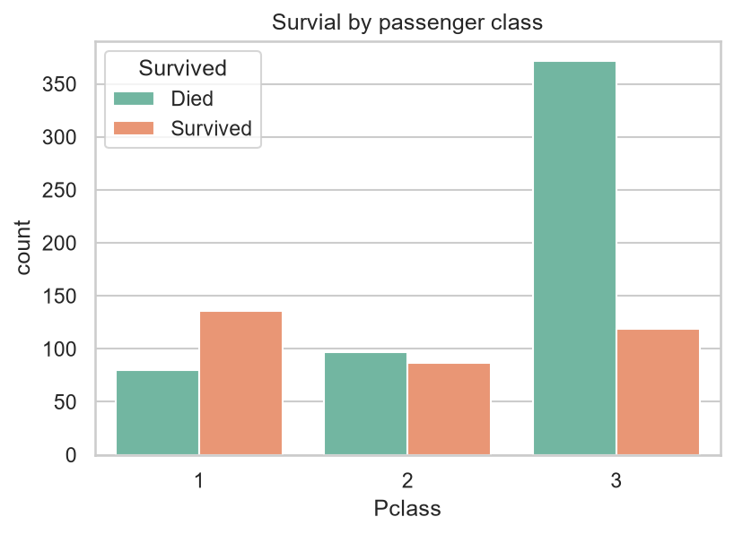

# Titanic Dataset — Exploratory Data Analysis

A comprehensive Exploratory Data Analysis (EDA) of the famous Titanic dataset to uncover the factors that influenced passenger survival.

## Business Question
Which passenger characteristics (age, sex, class, fare) had the strongest impact on survival rates?

## Tech Stack
- Python
- Pandas (Data manipulation & cleaning)
- Matplotlib & Seaborn (Visualization)
- Scikit-Learn (Machine Learning)
- Jupyter Notebooks

## Key Insights
1. **Gender:** Females had a significantly higher survival rate compared to males.
2. **Class:** Passenger class was a strong predictor of survival; 1st class passengers had the highest survival rate.
3. **Fare:** Paying a higher fare was positively correlated with a higher chance of survival.

## Machine Learning Baseline
After completing the EDA, I built a baseline predictive model. 
- **Features Used:** Pclass, Age, SibSp, Parch, Fare, Sex (One-Hot Encoded), Embarked (One-Hot Encoded).
- **Model:** Logistic Regression.
- **Result:** Achieved a **78.09% accuracy** and significantly improved recall for survivors by including the `Sex` feature.

## Project Structure
- `data/`: Contains the raw Titanic dataset.
- `notebooks/titanic_eda.ipynb`: The main Jupyter Notebook with all code, cleaning steps, visualizations, and detailed insights.
- `notebooks/titanic_ml_baseline.ipynb`: Machine Learning baseline model (Logistic Regression).
- `images/`: Visual highlights for the README.

## Visual highlights



## How to Run
1. Clone this repository.
2. Create a virtual environment: `python -m venv .venv`
3. Activate the environment and install dependencies:
   ```bash
   pip install -r requirements.txt